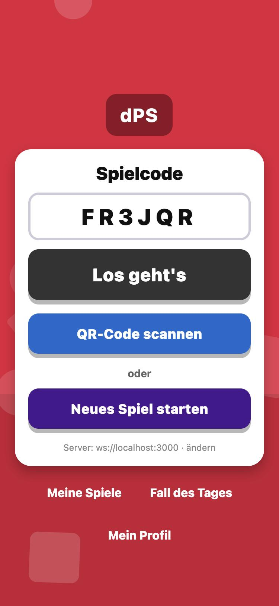
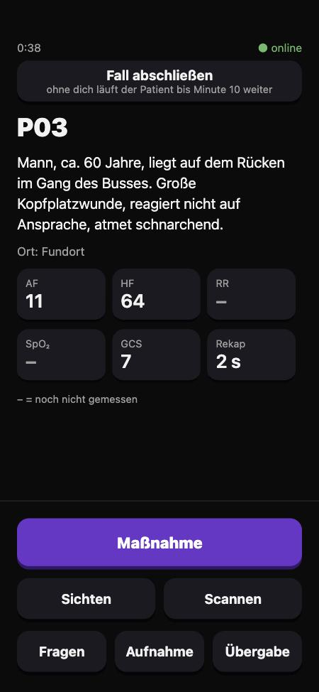
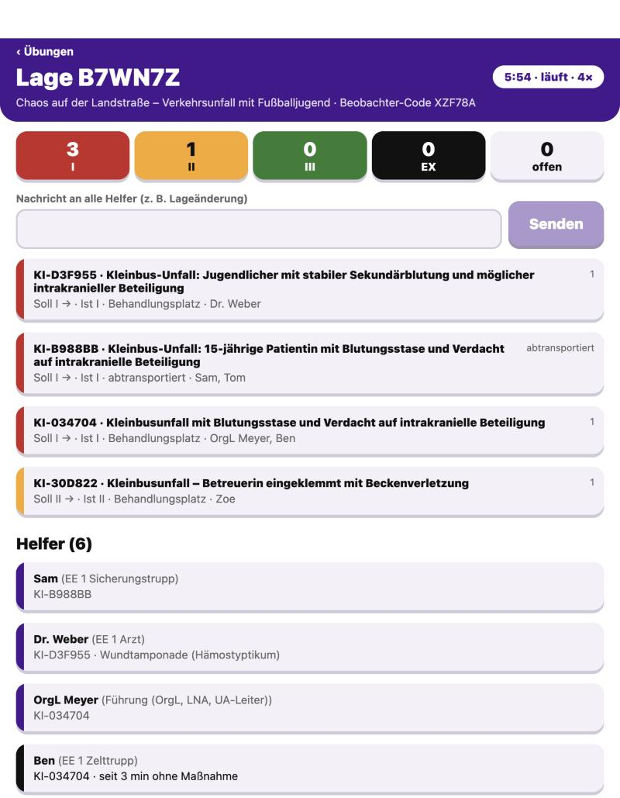
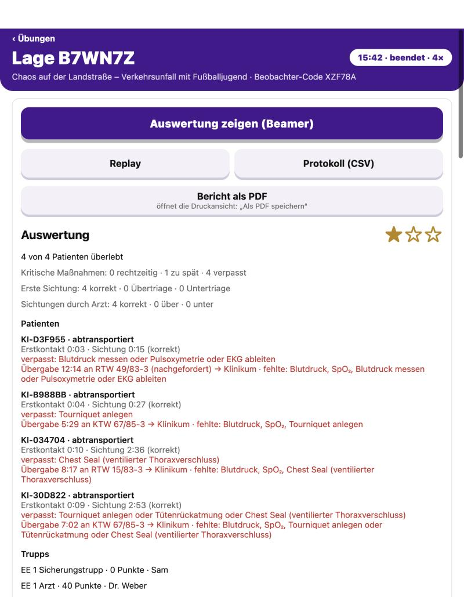
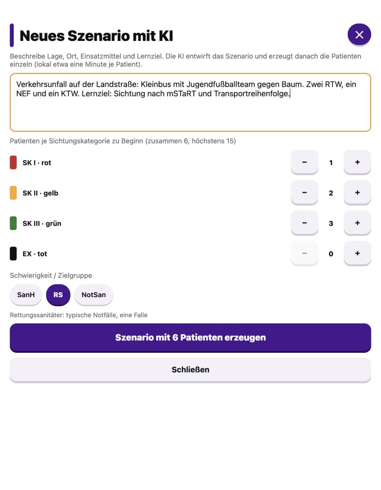
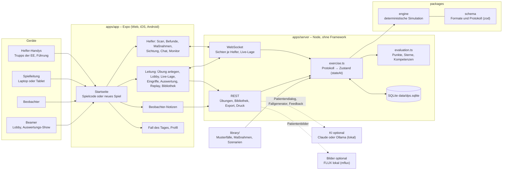

# dPS-App

Digitale dynamische Patientensimulation für MANV-Übungen im Rettungsdienst: Helfer scannen QR-Patienten mit dem eigenen Handy, Patienten verändern sich je nach Behandlung, Praxisanleiter sehen die Lage live und bekommen eine Auswertung.

Eine Startseite für alle: Spielcode eingeben (Übung, Trupp oder Beobachter) oder ein neues Spiel starten – ohne Konten und ohne E-Mail.
Übungen laufen mit Einsatzeinheiten (Sicherungstrupp, Arzt, Zelt- und Techniktrupp) und einer Führung, Patienten lassen sich im Chat befragen,
die Leitung sieht alles live, greift ein und bekommt Auswertung, Replay und Bericht. Fälle und ganze Szenarien erzeugt bei Bedarf eine KI
(Claude oder lokal), der Betrieb geht auch ganz ohne Internet.

<table>
  <tr>
    <td align="center"><br>Startseite: Spielcode oder neues Spiel</td>
    <td align="center"><br>Helfer: Patient, Werte, Maßnahmen</td>
    <td align="center"><br>Leitung: Lage live</td>
  </tr>
  <tr>
    <td align="center"><br>Auswertung nach der Übung</td>
    <td align="center" colspan="2"><br>Szenario mit KI: Patienten je Sichtungskategorie, Zielgruppe</td>
  </tr>
</table>

## Aufbau



```text
apps/app/          App (Expo): Startseite, Helfer, Spielleitung, Beobachter, Fall des Tages, Profil
apps/server/       Übungsserver: REST für die Spielleitung, WebSocket für Helfer und Live-Lage, SQLite (node:sqlite) in data/
packages/schema/   Szenarioformat und Protokoll App <-> Server (zod)
packages/engine/   Simulations-Engine: initial, validate, apply, tick, visible, targetSk, triage
library/           113 Fälle (P01–P13, I001–I100), Maßnahmenkatalog, 101 Szenarien, ideas/ als Quelle, import/ zum Einlesen (CC BY 4.0)
```

Ein Helfer-Handy schickt nur Absichten („Tourniquet an P01“); der Server prüft sie, protokolliert sie mit Übungszeit und berechnet
daraus den Zustand aller Patienten neu. Jedes Handy bekommt nur seine eigene Sicht, die Leitung die ganze Lage.

Die Engine ist deterministisch: `events.reduce(apply, initial(scenario, defs, settings, seed))` ergibt immer denselben Zustand.
Der Server speichert nur angenommene Helfer-Aktionen und berechnet den Zustand daraus neu (`stateAt`). So landen offline gepufferte Aktionen an ihrer echten Zeit.

## Fallbibliothek

Fest eingebaut sind 113 Fälle und 101 Szenarien: die Musterfälle P01–P13 mit dem Szenario „Busunfall“ sowie die
100 Fall-Ideen (I001–I100) und 100 Szenario-Ideen (S001–S100) aus `library/ideas/`, als spielbare Verläufe umgesetzt.
Jeder Fall besteht die automatische Prüfung und startet in der Sichtungskategorie der Idee (ein Test hält das fest).
Der Maßnahmenkatalog umfasst 71 Maßnahmen, darunter ärztliche Medikamente, Defibrillation, i.o.-Zugang, Dekontamination und Geburt.
Kinder werden mit kindgerechten Atemgrenzen gesichtet (JumpSTART); bei aussichtslosen Fällen zählt SK IV (abwartend) als richtig.
Szenarien erreichen die geplante Zahl Betroffener, indem Fälle mehrfach ausgelegt werden: „I011-2“ ist eine zweite Karte von I011
mit eigenem Verlauf. Kräfte, die keine Fahrzeuge sind (Feuerwehr, OrgL, RTH …), stehen in der Lagebeschreibung.
Was überarbeitet wurde und welche fachlichen Grenzen bleiben, steht in [docs/fallpruefung.md](docs/fallpruefung.md).

## Fertige Szenarien zum Importieren

In `library/import/` liegen mit Claude (Opus 5.5) erzeugte Szenarien, jeweils mit Lage, Fahrzeugen und allen Fallverläufen.
In der App unter Bibliothek → Szenarien → „Szenario aus Datei importieren“ einlesen; jeder Fall wird dabei erneut geprüft.

| Datei | Lage | Patienten (I/II/III/EX) | Zielgruppe |
|---|---|---|---|
| `reisebus-autobahn.json` | Reisebus mit Seniorengruppe auf der Seite, Blutverdünner und Vorerkrankungen | 8 (2/2/3/1) | RS |
| `pflegeheim-brand.json` | Nächtlicher Brand im Pflegeheim, Rauchgas, CO, Kälte, Demenz | 6 (2/2/2/0) | RS |
| `schule-chemieunfall.json` | Verpuffung im Chemieraum einer Realschule, Verbrennungen, Reizgas, Panik | 7 (1/2/4/0) | SanH |
| `stadtfest-panik.json` | Massenpanik am Absperrgitter, Thoraxtrauma, Becken, verkannte Hypoglykämie | 8 (2/3/2/1) | NotSan |

KI-Fälle sind Entwürfe: vor dem Einsatz von Praxisanleiter oder Arzt prüfen lassen.

## Entwickeln

Node 24 oder neuer (führt TypeScript direkt aus).

```bash
npm install
npm test
npm run typecheck
```

Server und App im Browser starten:

```bash
npm run server
npm run web -w @dps/app
```

Eine Startseite für alle, ohne Konten und ohne E-Mail: Spielcode eingeben (Übung, Trupp oder Beobachter) oder
„Neues Spiel starten“. Das Gerät der Spielleitung bekommt dabei still einen Schlüssel; daran hängen seine Spiele und eigenen Fälle
(„Meine Spiele“ auf der Startseite). Übung mit Einsatzeinheiten anlegen,
Zettel drucken (`/print/<CODE>`: Übungscode, ein Code je Trupp, QR-Zettel je Patient) und starten.
Je Einsatzeinheit gibt es Sicherungstrupp (Aufnahme und Abgabe), Arzt (Erstsichtung), Zelt- und Techniktrupp (Versorgung und Nachsichtung). Nach dem Ende zeigt die Lage die Auswertung;
„Berichte freigeben“ schickt jedem Helfer seinen Bericht. Punktewerte stehen in `apps/server/src/evaluation.ts`.

Auf dem Handy: Expo Go oder Development Build, als Server `ws://<IP des Rechners>:3000` eintragen.
QR-Codes enthalten `dps:<CODE>:p01` und gelten nur für ihre Übung; ohne Kamera lässt sich die Patientennummer eintippen.

## Pilot: ohne App-Installation

Der Server liefert die App als Web-App mit aus. Helfer öffnen am Handy nur seine Adresse.

```bash
npm install
npm run build:web
npm run server
```

- **Vor Ort im WLAN:** siehe „Betrieb ohne Internet“ unten.
- **Im Internet mit HTTPS** (Kamera und QR-Scan im Browser): Server hinter einen Reverse-Proxy mit Zertifikat, z. B. Caddy:

  ```text
  dps.example.org {
    reverse_proxy localhost:3000
  }
  ```

  WebSocket läuft über dieselbe Adresse (`wss://`), die App erkennt sie automatisch.
- **Daten:** alles steckt in `data/dps.sqlite` (Geräteschlüssel, Übungen, Protokolle, eigene Fälle); vor und nach dem Pilot sichern.
- **Last:** `apps/server/test/load.test.ts` simuliert 12 Helfer über 60 Minuten; eine Aktualisierung dauert wenige Millisekunden.

## Betrieb ohne Internet (Laptop + WLAN-Router vor Ort)

Alles läuft auf einem Laptop oder Mini-PC; ein WLAN-Router ohne Internetanschluss verbindet die Handys.

```bash
npm install          # einmal vorher, mit Internet
npm run offline      # baut die Web-App und startet den Server mit HTTPS
```

- Beim Start zeigt der Server die Adresse für die Helfer (z. B. `https://192.168.8.20:3000`) und einen QR-Code dazu im Terminal.
- **Zertifikatswarnung:** Ohne Internet gibt es kein öffentliches Zertifikat. Der Server erzeugt beim ersten Start ein eigenes für seine
  WLAN-Adressen (`data/tls/`, neu bei anderem Netz). Jedes Handy bestätigt die Warnung einmal („Details/Erweitert → trotzdem öffnen“).
  HTTPS ist nötig, weil Handy-Browser Kamera (QR-Scan) und Mikrofon nur so freigeben. Ohne HTTPS (`npm run server`) geht alles außer
  QR-Scan und Spracheingabe; Codes und Patientennummern werden dann eingetippt.
- **QR-Scan** braucht kein Internet: Die Erkennung liefert der eigene Server mit aus.
- **KI** nur lokal: Ollama auf dem Laptop, z. B. `AI_DIALOG=local AI_GENERATOR=local LOCAL_AI_URL=http://localhost:11434 LOCAL_AI_MODEL=dps-gemma3 npm run offline`.
  Ohne KI antworten Patienten aus ihrem Gesprächsprofil (Vorschläge im Chat). Claude braucht Internet.
- **Sprache:** Vorlesen funktioniert offline. Die Spracheingabe nutzt die Spracherkennung des Browsers; Chrome braucht dafür Internet,
  ohne bleibt Tippen.
- Übungsdaten liegen in `data/`, nichts verlässt das Gerät.

## KI (optional)

Ohne KI funktioniert alles: Patienten antworten auf die SAMPLER-Vorschläge aus ihrem Profil. Mit KI sind freie Fragen und der Fallgenerator möglich.
Die KI formuliert nur; Befunde und Verlauf bestimmt immer die Engine, Diagnosen und Messwerte in Antworten werden abgefangen.

| Variable | Werte |
| --- | --- |
| `AI_DIALOG`, `AI_GENERATOR` | `claude`, `local` oder `off` (Standard: `claude` mit API-Key, sonst `local` mit `LOCAL_AI_URL`, sonst aus) |
| `ANTHROPIC_API_KEY` | API-Key aus der Anthropic Console (Dialog: Claude Haiku 5.5, Generator: Claude Opus 5.5) |
| `ANTHROPIC_WORKSPACE_ID` | nur für Schlüssel, die keinem Workspace zugeordnet sind: Workspace-ID (`wrkspc_…`) aus der Console |
| `LOCAL_AI_URL`, `LOCAL_AI_MODEL` | OpenAI-kompatibler Server, z. B. Ollama: `http://localhost:11434` und `gemma3:4b` (Standard) |

Lokal mit Ollama:

```bash
brew install ollama && brew services start ollama
ollama pull gemma3:4b
ollama create dps-gemma3 -f apps/server/Modelfile
AI_DIALOG=local AI_GENERATOR=local LOCAL_AI_URL=http://localhost:11434 LOCAL_AI_MODEL=dps-gemma3 npm run server
```

`dps-gemma3` ist gemma3:4b mit 16k Kontext; der Fallgenerator braucht das (Ollama nimmt sonst 4096 Token). Ein Fall dauert lokal etwa 30–60 s.
Ist die KI nicht erreichbar, antworten Patienten auf die Vorschläge weiter aus ihrem Profil.

`gemma3:4b` antwortet auf einem Mac mit Apple M4 und 16 GB in 3–4 s und braucht 3,4 GB Arbeitsspeicher. Größere Modelle wie `llama3.1:8b` liefen dort
neben Browser und Entwicklungsserver wegen Speichermangels zu langsam, `llama3.2:3b` erfand Fakten. Kleine Modelle verdrehen gelegentlich
Profilfakten; für den Pilot lieber Claude nutzen oder die Antworten stichprobenartig prüfen.

Ganze Szenarien: In der Bibliothek unter „Szenarien“ entwirft die KI aus einer Idee Lage, Einsatzmittel und 1–15 Patienten; die Patienten
entstehen danach einzeln im Hintergrund (lokal etwa eine Minute je Patient). „Patient dazugenerieren“ ergänzt jedes Szenario, auch den Busunfall.
Patientenbilder (optional, nur macOS mit Apple Silicon): Aus dem Bildtext eines Falls zeichnet FLUX.2 Klein 4B (Apache 2.0) lokal ein
Bild im Stil einer Lehrbuch-Illustration, etwa 40–60 s je Bild, bis zu 9 GB Arbeitsspeicher. Es erscheint nur in der App (Fallansicht und Helfer-Ansicht), nicht auf den Druckzetteln.
Haltung und Umgebung gelingen gut, Verletzungsdetails oft nicht: Bilder einmal ansehen, maßgeblich bleibt der Text.

```bash
brew install uv && uv tool install mflux
IMAGE_GEN=mflux npm run server   # erster Aufruf lädt das Modell (~15 GB); anderer Pfad über MFLUX_BIN
```

KI-Fälle sind spielbar, sobald sie die automatische Prüfung bestehen (Format, Wertebereiche, erreichbare Regeln, Soll-SK);
fehlerhafte bleiben mit Prüfbericht in der Bibliothek. Fachlich durchlesen sollte sie trotzdem jemand.

## Lizenz

Code: [AGPL-3.0](LICENSE). Inhalte der Bibliothek: [CC BY 4.0](library/LICENSE.md).
